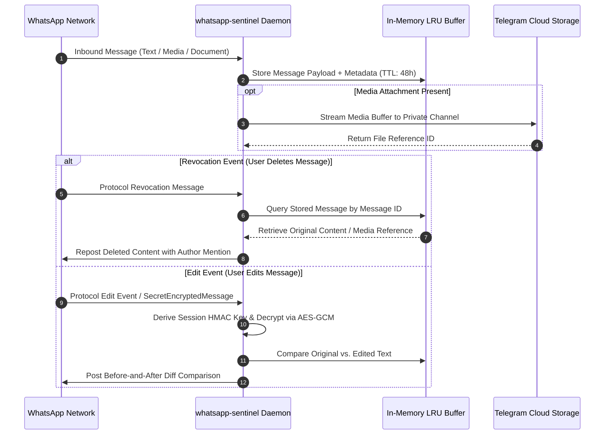

<div align="center">
  <h1>whatsapp-sentinel</h1>
  <p>WhatsApp automation bot built on Baileys with Anti-Delete recovery, AES-GCM edit payload decryption, and Telegram Cloud archival.</p>

  <p>
    <a href="https://github.com/itsgoharrehman/whatsapp-sentinel/releases"></a>
    
    
    
    
    <a href="https://github.com/itsgoharrehman/whatsapp-sentinel/stargazers"></a>
    <a href="https://github.com/itsgoharrehman/whatsapp-sentinel/issues"></a>
  </p>
</div>

---

## Overview

whatsapp-sentinel is a resilient WhatsApp automation daemon engineered on `@whiskeysockets/baileys`. It provides real-time intercept and recovery for revoked messages, cryptographic decryption of edit payloads, and permanent offloading of media assets directly to a private Telegram channel.

By utilizing Telegram's Bot API as an object and document storage layer, the bot maintains a strict zero-disk local footprint, eliminating local storage accumulation on server hosts.

## Architecture and Data Flow



## Core Capabilities

### 1. Anti-Delete Recovery Engine
* Intercepts protocol message revocation events across direct chats and group conversations.
* Recovers text, voice notes, photos, videos, stickers, and documents.
* Reposts the original content back to the chat mentioning the sender and the deleter.

### 2. Anti-Edit Decryption Pipeline
* Handles standard message edits and encrypted `SecretEncryptedMessage` edit payloads.
* Performs key derivation and AES-GCM decryption locally.
* Tracks multi-stage sequential edits, highlighting exact modifications.

### 3. Zero-Disk Telegram Cloud Archival
* In-flight media buffers are immediately offloaded to a designated Telegram storage channel.
* Local operational state retains zero heavy binary files on disk, ensuring persistent lightweight execution.

## Prerequisites

* **Runtime**: Node.js 18.x or 20.x LTS.
* **WhatsApp Account**: Primary or secondary phone number to link via Baileys multi-device pairing code or QR scan.
* **Telegram Bot**: Telegram Bot Token (from `@BotFather`) and private Channel ID.

## Installation and Quickstart

### 1. Clone the Repository

```bash
git clone https://github.com/itsgoharrehman/whatsapp-sentinel.git
cd whatsapp-sentinel
```

### 2. Install Dependencies

```bash
npm install
```

### 3. Configure Environment

Copy the example environment file and configure your credentials:

```bash
cp .env.example .env
```

Edit `.env`:

```env
# Administrative and Channel Configuration
ADMIN_NUMBER=923238522260
TELEGRAM_ENABLED=true
TELEGRAM_BOT_TOKEN=your_bot_token
TELEGRAM_CHANNEL_ID=your_channel_id

# Operational Tuning
RESEND_DELAY_MS=3000
CACHE_TTL_MS=172800000
PORT=3000
```

### 4. Run the Daemon

```bash
# Direct execution
node Anti_delete_bot.js

# Production daemon via PM2
npm install -g pm2
pm2 start Anti_delete_bot.js --name "whatsapp-sentinel"
pm2 save
```

On first execution, scan the terminal QR code using WhatsApp (Linked Devices) to establish the session.

## Configuration Reference

| Variable | Type | Default | Description |
| :--- | :--- | :--- | :--- |
| `ADMIN_NUMBER` | String | Required | WhatsApp phone number with international country code (no `+` or spaces). |
| `TELEGRAM_ENABLED` | Boolean | `true` | Toggles media archival to Telegram Cloud. |
| `TELEGRAM_BOT_TOKEN` | String | Optional | Bot token provided by Telegram @BotFather. |
| `TELEGRAM_CHANNEL_ID` | String | Optional | Unique Telegram channel ID for media archival. |
| `RESEND_DELAY_MS` | Number | `3000` | Delay in milliseconds before reposting recovered deleted messages. |
| `CACHE_TTL_MS` | Number | `172800000` | In-memory message buffer retention period (default: 48 hours). |
| `PORT` | Number | `3000` | Port for the HTTP health-check server. |

## Security and Operational Guidelines

* **Session Token Isolation**: Baileys multi-file authentication creates local session credentials in `auth_info_baileys/`. This directory is strictly ignored by `.gitignore` and must never be exposed or committed.
* **Zero Plaintext Secrets**: Telegram bot tokens and admin phone numbers are read strictly from process environment variables.
* **Rate Limiting**: Repost delays (`RESEND_DELAY_MS`) mitigate aggressive message bursts to prevent automated WhatsApp spam detection triggers.

## License

Proprietary Software License. Copyright (c) 2024-2026 Gohar Rehman. All rights reserved. For private operational use only.